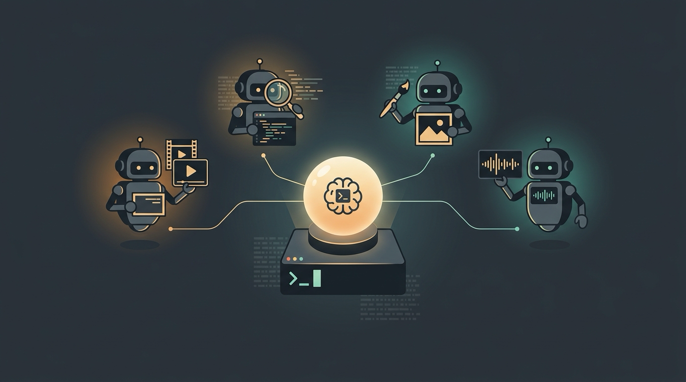

# sdd: Subagent-Driven Development



sdd lets Claude hand a job to another CLI and get a clean answer back.

Claude stays the brain. But some jobs a different tool just does better: transcribing a video, a second pair of eyes on your diff, painting an image, grinding through a scoped refactor. So instead of Claude trying to do all of it in one crowded context, sdd spins the right CLI up as a child process right in your repo, lets it do the one thing, and hands back a tidy `{status, summary, artifacts, raw}`. You keep a clean diff and Claude keeps a clear head.

It's one Claude Code plugin: an MCP server plus a couple of Skills.

> Fun aside: the banner up top was generated by sdd itself, with the `agy-image` harness.

## What you can actually do with it

- **Transcribe an Instagram reel.** Point the video pipeline at a URL (YouTube, Instagram, TikTok, X) and get back the audio, a transcript, and scene-cut keyframes. Great for "what's actually in this video" without watching it.
- **Get a second opinion on your code.** Hand your diff to `codex`, `grok`, `kimi`, `qwen`, or `mistral` and get an independent review back, verdict and findings, while Claude keeps driving.
- **Generate an image.** Ask the `agy-image` harness (Nano Banana) for a PNG. That's how the banner above got made.
- **Hand off the hard stuff.** Give a gnarly refactor or a deep-reasoning task to `codex-sol` on the flagship tier and let it churn in the background.
- **Fan out.** Kick off a bunch of these at once. Each dispatch runs in parallel and returns right away, so Claude can start three reviews and collect them as they land.

## How it works

Three moves, and the first one never blocks:

1. `dispatch` a prompt to a named adapter. You get a `jobId` back immediately. The harness runs in the background.
2. Check in with `status`, or block on `wait` until it's done.
3. Collect the structured result with `result`.

Seven MCP tools drive the whole thing: `dispatch`, `status`, `result`, `wait`, `cancel`, `list_adapters`, and `check_adapter`. Job state lives in memory for the session, so a server restart clears it (that's fine for v1, no disk persistence yet).

One thing that's on you, not the server: every agent harness runs wide open (it can edit the tree you hand it), and every dispatch runs in parallel. So if two jobs would write the same directory, keeping them apart is the caller's job. sdd serializes nothing.

## Install

It ships in the [rtd marketplace](https://github.com/ryanthedev/rtd-claude-inn). Add that once, then install:

```
/plugin marketplace add ryanthedev/rtd-claude-inn
/plugin install sdd@rtd
```

That wires up the MCP server and auto-discovers the `subagent-driven-development` and `video-ingest` skills. You'll need `bun >= 1.3.0`. Run `bun install` for the two deps (`@modelcontextprotocol/sdk`, `zod`).

The video pipeline also shells out to three tools that `bun install` doesn't manage. Grab them and run the preflight:

```
brew install yt-dlp ffmpeg
pip install -U mlx-whisper      # Apple Silicon speech-to-text
bun run src/lib/preflight.ts    # tells you what's present, what's missing
```

## The adapters

Fourteen ship today. `list_adapters` shows you which ones are installed, and `check_adapter` tells you whether one is actually logged in and usable (installed isn't the same as usable).

| Group | Adapters | For |
|---|---|---|
| Agent harnesses | `codex`, `codex-high`, `codex-low`, `codex-sol` | Review, second opinions, implementation across Codex reasoning tiers |
| | `agy` | Review / implement |
| | `grok`, `kimi`, `qwen`, `mistral` | Second opinions from xAI, Moonshot, Alibaba, and Mistral |
| Image + vision | `agy-image` | Text to a PNG (Nano Banana) |
| | `agy-vision` | Fuse a transcript + keyframes into one understanding JSON |
| Video pipeline | `yt-dlp`, `whisper`, `ffmpeg-frames` | Pull a video, transcribe it, extract scene-cut keyframes |

Each harness has its own quirks: flag ordering, the marker it emits, what auth it needs. The full per-harness reference (capabilities, auth, and every gotcha) lives in **[`skills/subagent-driven-development/references/harnesses.md`](skills/subagent-driven-development/references/harnesses.md)**. For the orchestration doctrine (when to fan out, when to serialize, how to use `wait`) see **[`skills/subagent-driven-development/SKILL.md`](skills/subagent-driven-development/SKILL.md)**.

## Adding an adapter

Drop a file in `src/adapters/` that exports the `Adapter` shape (`name`, `buildArgs`, `injectContract`, `parseResult`, plus optional `binary`/`probeable`). There's no registry to edit. Discovery picks it up, skips anything malformed with a warning instead of crashing, and ignores infra files (`_`-prefixed helpers, tests, `discover.ts`/`types.ts`). See the harness reference and any existing adapter for the pattern.

## Development

```
bun install
bun test           # full suite
bunx tsc --noEmit   # strict typecheck
```

`plugin.json`'s `version` field is the single version source, read at startup (`src/register.ts:readVersion`). Bump it there and nowhere else.

Found a rough edge, or want to add a harness? Open an issue or a PR. Happy to help.
